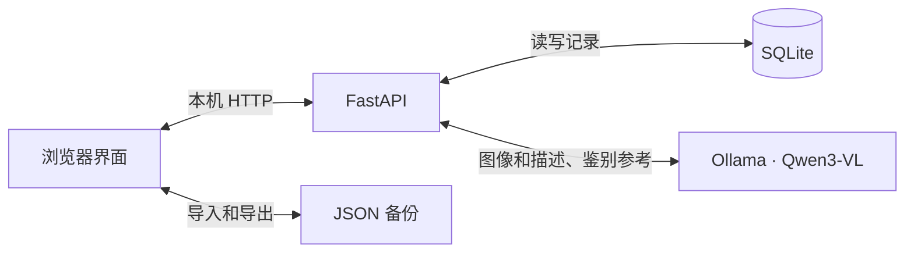

# DermSage Skin Health Assistant V1.0

DermSage 是一个运行在本机的皮肤健康记录和图文观察研究原型。用户可以管理健康记录、预览图片，并使用本地视觉语言模型查看有限病种范围内的鉴别参考。模型会展示观察要点、候选的支持线索及仍需核实的信息，输入不足时会留空候选。本原型未经临床验证，输出仅供科研演示和就诊沟通参考。

## 功能

- 记录部位、持续时间和文字描述，支持查询、编辑、筛选和删除。
- 预览图片，使用文字、图片或图文组合请求本机模型生成鉴别参考。
- 将用户主动保存的文字记录写入 SQLite，支持导出 JSON 和导入备份。

## 本地启动

准备 Python 3.10 或更高版本、现代浏览器。在仓库根目录执行以下 PowerShell 命令。已在 Windows 11 和 Python 3.14 上验证。

```powershell
python -m venv .venv
.\.venv\Scripts\python.exe -m pip install -r requirements.txt
.\.venv\Scripts\python.exe launch.py
```

浏览器打开 <http://127.0.0.1:8765/>。接口文档位于 <http://127.0.0.1:8765/docs>。在启动窗口按 `Ctrl+C` 结束服务。端口被占用时，可在启动命令后追加 `--port 8766`，再访问相应端口。

macOS 或 Linux 可以用 `python3 -m venv .venv` 创建环境，再用 `.venv/bin/python` 执行安装和启动命令。

### 启用本机图文模型

1. 安装并运行 [Ollama](https://ollama.com/download)。使用命令行启动时，在一个单独的终端运行 `ollama serve`。DermSage 通过 `127.0.0.1:11434` 连接它。
2. 在另一个终端下载 [Qwen3-VL 模型](https://ollama.com/library/qwen3-vl:2b-instruct)。

   ```text
   ollama pull qwen3-vl:2b-instruct
   ```

3. 回到页面点「检查模型状态」，显示就绪后选择图片或填写描述，再点「查看鉴别参考」。模型未就绪时仍可管理记录和备份。

## 架构与目录



| 文件 | 用途 |
| --- | --- |
| `index.html`、`styles.css`、`app.js` | 界面、图像预览、记录与模型接口交互 |
| `server.py` | FastAPI 本机服务、静态资源、SQLite 和记录接口 |
| `inference.py` | 本机 Ollama 调用、输入校验和结构化结果处理 |
| `launch.py`、`启动 DermSage.cmd` | Python 启动入口和 Windows 启动脚本 |
| `requirements.txt` | Python 依赖清单 |
| `DermSage-logo.png` | 项目标志 |

数据库默认保存在 `data/dermsage.sqlite3`，可用启动参数 `--db <路径>` 指定其他文件。图片与模型输出在本次观察流程中临时处理，SQLite 保存的是用户主动提交的记录字段。备份 JSON 可能包含个人记录，请妥善保存。
